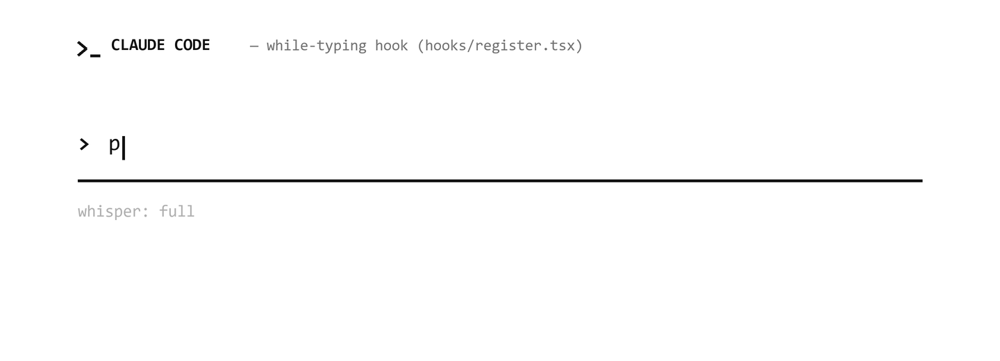
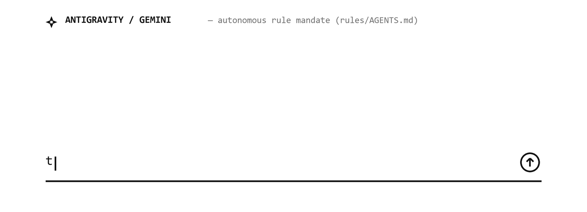
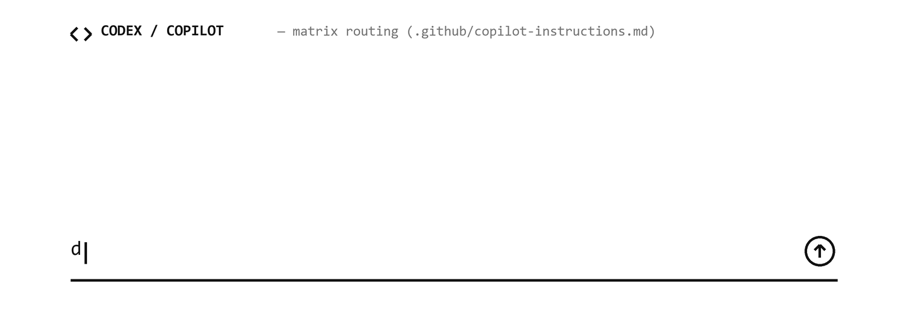

<p align="center">
  
</p>

<h1 align="center">skill-whisper</h1>

<p align="center">Suggests the right installed skill while you type in Claude Code, and routes prompts to your installed skills in Antigravity, Gemini CLI, OpenAI Codex, and GitHub Copilot.</p>

<p align="center">
  <a href=".claude-plugin/plugin.json"></a>
  <a href="LICENSE"></a>
  <a href="universal-registry/test_system.py"></a>
  <a href="https://www.buymeacoffee.com/5842055734thperson"></a>
</p>

Skill Whisper is a tool for people with many skills installed across AI coding agents. In Claude Code, it reads the skills on your machine, suggests the one that fits your draft while you type, and puts `/skill` at the start of your message when you type `;;`. It also tells Claude which skills are manual-only, so Claude says "run `/name`" instead of doing that work itself.

For Antigravity, Gemini CLI, OpenAI Codex, and GitHub Copilot, Skill Whisper includes a universal registry and compiler (`universal-registry/`) that generates instruction files (`AGENTS.md`, `GEMINI.md`, and `.github/copilot-instructions.md`) from the same skill definitions.

## How it works across agents

Each agent handles user input differently, so Skill Whisper uses the native mechanism of each tool.

### Claude Code

In Claude Code, a local hook watches your draft before you send it. When your words match an installed skill, the status line shows it, and the `/whisper-ui` pane offers it as a button. A terminal session also shows a dim inline hint; the Claude desktop app does not draw that hint. Typing a space and `;;` at the end of your draft moves the matched `/skill` to the front of your prompt before it goes to the model.

<p align="center">
  
</p>

### Antigravity and Gemini CLI

Antigravity and Gemini CLI do not expose a pre-send keystroke hook. Instead, Skill Whisper compiles an instruction rule into `AGENTS.md` and `GEMINI.md`. You type and send your prompt as usual. When an installed skill matches your task, the agent replies with a `Skill:` line naming the skill, reads that skill's `SKILL.md` file with `read_file`, and follows its steps.

<p align="center">
  
</p>

### OpenAI Codex and GitHub Copilot

OpenAI Codex and GitHub Copilot read repository instructions from `AGENTS.md` and `.github/copilot-instructions.md`. You send your prompt in the chat box, and the agent checks the compiled routing table, loads the matching `SKILL.md` runbook, and replies with the output.

<p align="center">
  
</p>

## Install

### Claude Code

Install the mod from this repository with one command. At the prompt of a Claude Code terminal session, run:

```text
/plugin install skill-whisper --marketplace 5842055734thperson/skill-whisper
```

From a shell, run:

```bash
claude plugin install skill-whisper --marketplace 5842055734thperson/skill-whisper
```

In the Claude desktop app, where `/plugin` does not run, use the plugin menu:

1. Click **+** next to the prompt box, then **Plugins**.
2. Click **Add marketplace** and enter `5842055734thperson/skill-whisper`.
3. Click **Add plugin** and pick **skill-whisper**.

The mod starts at the `full` level. Your status line shows `💬 whisper: full` once it is active.

### Antigravity and Gemini CLI

Build the rule files from the skills on your machine (see [How the skill library and compiler work](#how-the-skill-library-and-compiler-work)), then copy them into your project root or your global Gemini config directory:

```bash
cp universal-registry/generated/antigravity/AGENTS.md ./AGENTS.md
cp universal-registry/generated/antigravity/GEMINI.md ./GEMINI.md
```

### OpenAI Codex and GitHub Copilot

Build the routing table the same way, then copy it into your repository's `.github/` folder (or root `AGENTS.md` for Codex):

```bash
mkdir -p .github
cp universal-registry/generated/copilot/copilot-instructions.md .github/copilot-instructions.md
```

## Commands

In Claude Code, all commands start with `/whisper`. The level you pick is saved and kept in later sessions:

| Command | What it does |
|---|---|
| `/whisper` | Shows the current level. |
| `/whisper full` | Claude invokes a matching skill, names manual-only skills, and you get suggestions while you type. |
| `/whisper lite` | Claude only suggests a skill in one line and asks before using it. No suggestions while you type. |
| `/whisper off` | Turns the mod off. Nothing is added to Claude's context. |
| `/whisper-help` | Lists your installed skills, grouped by plugin, with a short description of each. |
| `/whisper-ui` | Opens the control center pane: level buttons, the current suggestion, and every skill as a button. |
| `/whisper-me-a-skill` | Searches online registries (skills.sh and GitHub) for a new skill when you ask for one, and asks before installing it. |

Clicking a skill in the `/whisper-ui` pane puts `/skill` in front of what you already typed. It does not erase your draft.

## Typing shortcut

In Claude Code at the `full` level, end your draft with a space and `;;` to put the suggested skill at the start of your message. With a chart skill such as `dataviz` installed:

```text
monthly revenue chart ;;
```

becomes:

```text
/dataviz monthly revenue chart
```

While you type, the status line shows the current suggestion, for example `💬 /dataviz · charts and dashboards · end with ;;`. The skill names you see depend on what you have installed. Manual-only skills are tagged `[manual]`. If no skill fits, `;;` leaves your text alone. A lone search like `/grafik ;;` becomes `/dataviz `.

Suggestions appear on their own only for task-like drafts: questions ("what does...", "nedir") get no hint, and a weak match needs an action word such as *make*, *draw*, or *çiz*. `;;` skips that check, because you asked. It also never fires inside a fenced code block or on shell lines like `echo x;;`, since it needs a space before it.

The shortcut is typed text because the Claude desktop app does not pass key combinations to mods. In a terminal session you also get a dim inline hint and Tab completion.

## Online skill search (`/whisper-me-a-skill`)

When you need a skill that is not installed on your machine, run:

```text
/whisper-me-a-skill <topic>
```

This skill has `disable-model-invocation: true`, so the agent cannot trigger it on its own. When you run it, it searches [skills.sh](https://skills.sh) and GitHub using `npx skills find`, shows you the top matches, and waits for your confirmation before running `npx skills add`. On Windows, it runs `npx` through PowerShell so output is not lost in Git Bash pipes.

## How the skill library and compiler work

Skill Whisper builds its skill list in two ways:

1. **Runtime scan in Claude Code**: At session start, the mod reads every `SKILL.md` under `~/.claude/skills`, `~/.claude/plugins/cache`, and `~/.claude/plugins/synced`. It takes each skill's name, description, and `disable-model-invocation` flag, keeps only skills that appear in Claude Code's installed command list, and groups them by plugin. Run `/reload-plugins` after installing or removing a skill to refresh the list.
2. **Universal registry and compiler (`universal-registry/`)**: For cross-agent support and precomputed match phrases, `build_registry.py` scans the skills installed for Claude Code, Antigravity and Gemini on your machine and writes `universal-registry/skills_registry.json`, with multi-word English and Turkish trigger phrases. That file, and everything compiled from it, stays on your machine: git ignores it, because it lists every installed skill.

Build the registry, then compile it into agent-specific files using either the Python script or the native Rust binary:

```bash
python universal-registry/build_registry.py
```

```bash
# Python compiler (zero external dependencies)
python universal-registry/compiler.py

# Or build and run the Rust compiler (~19 ms)
cargo build --release --manifest-path universal-registry/compiler-rust/Cargo.toml
./universal-registry/compiler-rust/target/release/skill-whisper-compiler
```

Both compilers produce byte-for-byte identical output (verified by SHA-256 checks in [`universal-registry/test_system.py`](universal-registry/test_system.py)) under `universal-registry/generated/`:

- `claude/aliases.ts` (your Claude Code skills; copy it to `hooks/aliases.ts` to use it in the mod)
- `antigravity/AGENTS.md` and `antigravity/GEMINI.md` (your Antigravity and Gemini skills)
- `copilot/copilot-instructions.md` (the same skills, for GitHub Copilot and Codex)
- `universal/aliases.ts` (all of them)

To scan a folder of custom `SKILL.md` files on another machine and merge them into the compiled output, pass `--scan-dir`:

```bash
python universal-registry/compiler.py --scan-dir /path/to/your/skills
```

## Add your own match words

Suggestions while you type match your words against skill names, descriptions, and aliases in [`hooks/aliases.ts`](hooks/aliases.ts):

```typescript
export const ALIASES = {
  "dataviz": ["monthly revenue", "bar chart", "grafik ciz"],
}
```

To add match words across all agents at once, add them to `CURATED_ALIASES` in [`universal-registry/build_registry.py`](universal-registry/build_registry.py), or to a local `universal-registry/local_aliases.json` for skills you do not want in the repository, then rebuild. An entry is used in Claude Code only when that skill is installed. Single-word aliases are avoided in the default registry so common words in everyday prompts do not trigger unrelated skills.

## Privacy

Everything runs on your machine. The mod reads `SKILL.md` front matter in your local config folders. It calls no model during matching, and it sends nothing over the network unless you explicitly run `/whisper-me-a-skill` to search for a new skill online.

## Evaluation and test results

### Live Claude Code check (20 prompts)

These numbers are an early check from the initial Claude Code sessions. Each setup ran the same 20 prompts with `claude -p`, Opus 5.5, and at most 2 turns. Of those, 16 need a skill that Claude can start, and 4 need a manual-only skill. The no-mod and v0.3 runs also included 10 prompts that need no skill, and both stayed quiet on all 10:

| Setup | Skill invoked (of 16) | Manual skill named (of 4) |
|---|---|---|
| No mod | 8 | 0 |
| v0.3, hand-written routing table | 15 | 0 |
| v0.8, library built from installed skills | 15 | 3 |

In v0.8, the one auto miss (a slide deck) went to the host's Artifact tool, and the one manual miss (a design doc) went to the `docs` skill instead of `/egm:egm-draft`. See [`docs/process/README.md`](docs/process/README.md) and [`eval/README.md`](eval/README.md) for details.

### Universal registry and matcher test suite (author's machine, 347 skills)

After removing the single-word aliases that caused false hints and expanding the registry to 347 skills across Claude Code (144) and Antigravity/Gemini/Copilot (212), the automated test suite in [`universal-registry/test_system.py`](universal-registry/test_system.py) checks both compilers and the keyword matcher. These figures are from the author's machine; your counts depend on what you have installed:

| Check | Result |
|---|---|
| Positive skill recall (Claude Code, 144 skills; one prompt per skill, built from its own aliases) | 144 / 144 (100%) |
| Positive skill recall (Antigravity, Gemini, Copilot, 212 skills) | 212 / 212 (100%) |
| Positive skill recall (Universal dictionary, 347 skills) | 347 / 347 (100%) |
| Negative-control prompts (50 everyday coding questions that need no skill) | 48 / 50 quiet (96% specificity, 4% false-alarm rate) |
| Python and Rust compiler output parity | 100% identical SHA-256 across all 5 generated files |
| System verification suite (`test_system.py`) | 13 / 13 passed |

## Known limits

- Claude Code's built-in skills that have no `SKILL.md` file (for example `code-review` and `loop`) are learned from Claude Code's own skill list, which arrives with your first message. Until then they are not suggested while you type.
- Questions get no hint. A Turkish draft that ends in a question word (“efektin adı ne”) stays quiet even when a skill fits; `;;` still works there.
- Matching while you type uses keywords and phrases, so it can still miss an unusual phrasing or suggest a skill when a prompt shares domain terms with an installed plugin.
- In Antigravity, Gemini CLI, Codex, and Copilot, skill routing happens after you send your message because those hosts do not run a local pre-send keystroke hook.
- Tested with Claude Code 2.1.316 on Windows.
- Planned matcher work and its status are in [`docs/process/action_plan_v0.9.md`](docs/process/action_plan_v0.9.md).

## Develop and test

Clone the repository and run the checks from its root. The Claude plugin tests use a fake skill install, so they do not depend on your machine:

```bash
claude plugin validate .
claude plugin test .
```

To run the universal compiler and 13-stage verification suite (covering CLI flags, malformed input recovery, Python/Rust SHA-256 parity, compilation speed, target isolation, and a recall test over every skill in your registry):

```bash
python universal-registry/test_system.py
```

To load your working copy into a Claude Code session instead of the installed version, start Claude Code with `claude --plugin-dir .`.

## Project history

The design, measurements, and reviews behind each version are in [`docs/process/`](docs/process/README.md). The mod was called skill-pilot until v0.6.

## Support the project

Skill Whisper is free and MIT-licensed. If it saves you time, you can [buy me a beer](https://www.buymeacoffee.com/5842055734thperson). Bug reports and pull requests help too.

## License

[MIT](LICENSE)
